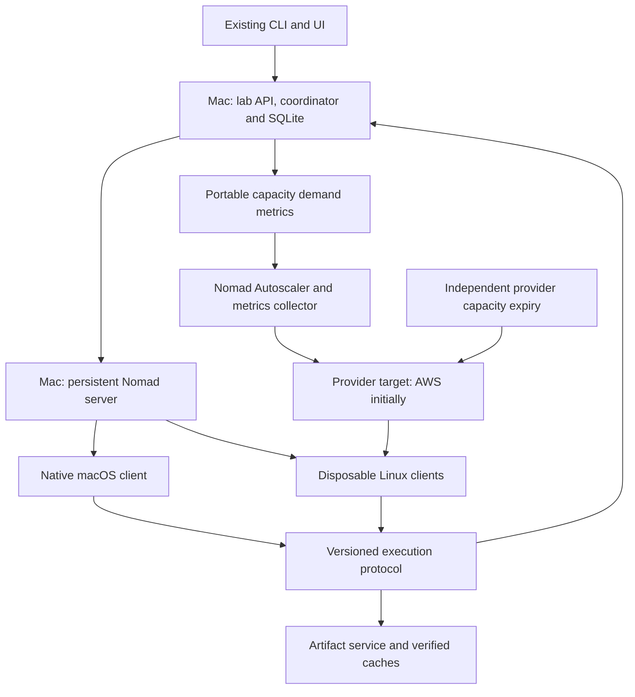

# Nomad migration plan

Proposed on 2026-10-25. Implementation is in progress; production execution has not been switched to Nomad.

Revised after PR #127: maximize cloud utilization by sharing nodes across experiments, profiles, measurements, and
builds within explicit CPU and memory budgets. Recording measurements does not automatically require a whole node.

Implementation has started in [the isolated execution prototype](nomad/README.md): reusable resource budgets,
Nomad batch-job rendering, and a TLS/ACL sandbox with real Linux sharing, hard-limit, OOM, and cancellation checks.
Durable execution ownership now has additive session, attempt, event, and outbox tables, explicit backend selection,
transactional leases/fencing, complete-iteration acceptance, and cancellation/rollback guards. Legacy queue and
restart recovery exclude Nomad-owned experiments. The worker API and actual Nomad reconciler follow in the stack;
there is no production selector yet. The connected stack now includes a separate worker listener, Nomad mTLS client,
signed allocation identities, resumable/checksummed HTTP artifacts and durable reconciliation/completion. The real
Linux integration test exercises coordinator restart and allocation loss. The stack also adds the portable manifest/executor, bounded verified ZIP cache,
an independent same-user process service and a provider-neutral OCI worker build. Approved Git export and checksum-verified worker build caching now run source builds inside the session budget, with permanent build-failure fencing; automatic queue preparation/admission remains outstanding. A provider-neutral capacity collector and shared CPU/memory packing policy now expose fresh demand, booting-worker
accounting, finite vCPU limits, purchasing restrictions, expiring manual requests and allocation reports. Provider-side
Spot infrastructure, signed fresh capacity grants, pinned Autoscaler policy rendering, Linux bootstrap/interruption handling and independent AWS expiry are implemented in [the opt-in infrastructure modules](infra/README.md). A GCP Spot reference module adds expiring IAM resize permission and independent zero-target expiry with the same worker protocol. Live AWS/GCP cloud acceptance remains required. Native service rendering/install,
shared legacy/Nomad ownership, priority/update draining and release retention are implemented behind explicit configuration. Native fixture execution and
cleanup are exercised on macOS CI; real Mac solver/JFR canaries and cloud gates remain required. Step 0 is still open: native Mac solver/JFR runs, independent process supervision after abrupt death, and session
replacement remain acceptance gates. The lab's production runner and cloud infrastructure are unchanged.

## Outcome and decisions

Run experiment execution through Nomad while retaining native macOS solves, portable cloud workers, and recovery
from Spot interruptions. Keep the lab's API, UI, experiment model, SQLite database, source trust policy, validation,
comparisons, and historical results.

Use one persistent Nomad server on the Mac initially, a native Mac client, and disposable Linux cloud clients.
The Mac remains an availability dependency, as it is today. Run the server and client as managed services, with
persistent state, TLS, ACLs, and an explicit single-server configuration; never use development mode for the lab.
Back up the Nomad server's state alongside the lab database. Additional servers, if later needed, belong together
on a low-latency network, rather than splitting a quorum between the Mac and clouds.

Use `raw_exec` on macOS so local solves remain native. Use the Docker task driver for Linux cloud workers with hard
CPU limits and bounded memory, covering the worker and all its child processes. Cloud worker images are portable
OCI artifacts with immutable identities and a configurable registry; they must not depend on ECR or another cloud's
registry API. Existing local reference solvers may continue to use their own Docker runtime. Verify compatibility
in step 0 and record driver/packaging differences as execution-environment changes.

Nomad owns process placement and allocation lifecycle. The lab retains admission by experiment priority, placement
exceptions, pairing, and between-iteration pause/yield decisions. This preserves the lab's benchmark semantics
without maintaining SSH sessions, remote process polling, or instance adoption as execution mechanisms.

Cloud portability means changing infrastructure modules, capacity targets, identity configuration, and artifact
storage configuration when changing providers. It does not mean that provider provisioning or Spot termination
notifications have a universal API. No provider SDK, CLI command, bucket name, or instance type belongs in an
experiment definition or the shared execution protocol.

## Target architecture

Worker HTTP traffic and Nomad RPC use an authenticated private network. Cloud clients need to reach the Nomad
server, worker API, and artifact endpoints; solver jobs do not require connectivity to each other. The existing
public HTTP relay is not automatically a transport for Nomad RPC. Provide a separate private route/VPN with
documented bootstrap, DNS, and credential rotation. A single Nomad server and the coordinator can be unavailable
together; recovery and cost controls must handle that explicitly.

Do not add Consul, Vault, a service mesh, or shared network filesystems as prerequisites for this migration.
Use native Nomad functionality and narrowly scoped bootstrap credentials; integrations can be added for a
demonstrated need later. Pin Nomad, Autoscaler, toolchain, and worker releases during step 0.

## Execution model

An experiment remains the user-visible job. Its plan contains stable iteration IDs: one problem, seed, and repeat,
with every configuration arm that must run on the same host. A profile entry point is an indivisible work item;
analysis and reference work keep their current local placement exceptions.

Create a real Nomad `batch` job for each bounded execution session of an experiment. A session runs on one node,
prepares its inputs once, pulls complete iterations belonging only to that experiment, and exits when its work
is exhausted, the lab requests a yield, or its node drains. Several sessions can participate in one experiment.
The session cannot choose another experiment, provision machines, or mutate the database directly.

This granularity avoids a Nomad submission and full toolchain startup for every short solve. Multiple cloud sessions
from different experiments share a node whenever their budgets fit. Size each session for its runnable work and
parallel limit, rather than reserving a whole host by default; use smaller sessions to fill remaining capacity.
Preserve the per-experiment, per-host case parallel cap across sessions. Profiles and measurement sessions use the
same resource-based admission as ordinary work and do not trigger whole-node reservations or draining other jobs.
Keep the existing one-local-experiment policy on the Mac initially and a local ownership lock against a concurrent
legacy runner. Do not assume Nomad CPU MHz, vCPUs, physical cores, or Mac performance cores are equivalent.

The worker preserves intra-iteration order/concurrency, JVM flags, timeouts, and measurement wrappers. If an
iteration is interrupted, discard its partial comparison and rerun all its arms on the replacement host. Completed
iterations survive loss of the session. An ordinary solver timeout or solver error is a recorded domain outcome;
it is not automatically a failure of the Nomad task that triggers infrastructure retries.

Use deterministic job IDs such as `lab-<experiment>-<execution-class>-<session>-<generation>` and the job registration
API. Persist submission intent before calling Nomad. A reconciler can discover whether an ambiguous registration
succeeded and retry the same identity. Start with ordinary generated job specifications; parameterized dispatch
is unnecessary and introduces distinct dispatch identities and payload limits.

## Resource budgets and sharing

Define a provider-neutral session budget in logical vCPUs, MiB of memory, and maximum active cases. Include solver
threads, benchmark/worker JVMs, JIT, GC, profiling overhead, and any preparation running in that allocation. Keep a
separate node reserve for the OS, Nomad, artifact transfer, and supervision. All active reservations must fit the
remaining node capacity; initially disable memory oversubscription. Translate the vCPU budget to Nomad's CPU units
using the node's fingerprinted topology/frequency, and verify the resulting runtime limit instead of assuming a
fixed MHz value per vCPU. Record the budget, actual CPU quota/period, memory ceiling, and enforcement mechanism.

On Linux, set the Docker task's `cpu_hard_limit = true` and a finite memory ceiling corresponding to its reservation.
Inspect the resulting cgroup CPU and memory limits and test the full process tree under load. Nomad's ordinary
`resources.cpu` is a relative share and can burst; a scheduler reservation, `nice`, JVM `ActiveProcessorCount`, or a
Gradle worker count alone does not establish a hard CPU ceiling. See
[Nomad CPU behavior](https://developer.hashicorp.com/nomad/docs/architecture/cpu) and the
[Docker task settings](https://developer.hashicorp.com/nomad/docs/job-declare/task-driver/docker).

The cap applies to the sum of all concurrent cases and helpers in a session. Choose case concurrency and JVM/thread
settings to fit that cap; keep any desired physical-core headroom explicit in the budget. A profile or measurement
session may use only part of a node, with ordinary work or another profile using the rest. Shared cache, memory
bandwidth, SMT siblings, host scheduling, and CPU frequency can still affect timing. Record colocated work and
cgroup throttling/OOM observations so comparisons describe the conditions actually measured; quotas do not make
shared-host timing identical to isolated timing. Keep all arms of an iteration on the same host and under the same
declared budget, while allowing background load to vary.

For example, a 16-vCPU cloud node with 2 vCPUs reserved for the host can admit three 4-vCPU solve sessions and one
2-vCPU build allocation, provided their memory budgets fit. No session grows past its CPU cap when its neighbors
finish. If an experiment needs less than its current reservation, end or resize sessions at safe iteration
boundaries so other queued work can use that capacity; do not create simultaneous replacement sessions that exceed
the budget. Dynamic resizing is optional for the first cut, but right-sized shared allocations are required.

Native macOS has no equivalent Linux cgroup CPU quota in this design. Keep bounded case concurrency, thread
settings, and host admission budgets, and report enforcement as advisory native scheduling. Do not claim that a
Nomad reservation or JVM flag hard-caps a native Mac process tree. The Linux hard-limit acceptance gate and the
native Mac admission/cleanup gate are distinct; native Mac execution remains a requirement.

## Durable state and worker contract

SQLite stays on the Mac. Workers receive neither database mounts nor access to its files. Add additive tables for:

- `execution_sessions`: experiment, backend, execution class, generation, Nomad job/allocation/node identities,
  expected worker release, desired state, and latest observation.
- `iteration_attempts`: stable iteration ID, monotonically increasing generation, session and allocation owner,
  claim token, lease expiry, state, start/end times, and accepted result manifest.
- `execution_events`: termination reason, retry classification, phase changes, and reconciliation observations.
- `execution_outbox`: durable Nomad submit/stop intents with stable identities and acknowledged outcomes.

An active attempt moves through `claimed -> preparing -> executing -> uploading -> committed`; invalidated attempts
end as `lost`, `cancelled`, or `superseded`. Existing case states remain the public projection. Case outputs from a
running attempt may be visible provisionally, but comparisons use accepted iteration results only.

Add a versioned worker API for session registration, claiming an iteration, renewing its lease, publishing case
progress/log chunks, requesting artifact transfers, and committing a result manifest. Every mutation checks the
session, allocation, iteration generation, and scoped token. Tokens are bound to one session and cannot submit
experiments, launch capacity, access other jobs, or read provider control credentials. Replacements obtain a new
allocation binding; a token copied from a superseded allocation cannot revive it.

Fence replacements in a transaction: invalidate the old generation before granting another. Duplicate delivery is
allowed; at most one attempt is accepted for an iteration. An old worker may still consume CPU during a partition,
but it cannot overwrite the accepted result. A worker that cannot renew its lease stops starting cases and stops
its process tree before its locally tracked lease expires. Use monotonic local timing and an expiry margin.

After all arms and artifacts are uploaded, the coordinator verifies checksums and atomically accepts the manifest
and case projection. Retrying a lost acknowledgement returns the accepted outcome. Cancellation increments/fences
the generation before stopping allocations, so a racing upload cannot turn a cancelled experiment into success.
Run source-witness checks centrally and derive experiment completion from durable attempts and the required check
state, rather than from `Crews` membership or Nomad job success alone.

Initial timings to validate: renew worker leases every 10 seconds, a 90-second lease, and a 10-second reconciliation
loop. These are starting values, not a promise that a cloud replacement boots within 90 seconds. Block renewal and
new claims when required local volumes are unavailable. Bound all lease and transfer operations by timeouts.

## Native Mac execution and process lifetime

Extract the existing launch, measurement, and termination logic into a reusable worker executor. Preserve BSD
`time -l`, JFR/compilation capture, process-group termination, and graceful timeout handling. Keep native JDK,
architecture, SIMD, memory, and CPU provenance. Do not claim hard CPU or memory isolation on macOS.

Nomad's `raw_exec` documentation specifically notes the risk of leaking processes that create new process groups.
This matters because the current runner deliberately creates process sessions. Implement a host-local supervisor
that records process identity/start time, forwards signals to the complete owned group, and cleans up after abrupt
worker or client death. Do not kill by an unchecked reused PID. The supervisor must remain outside the worker's
failure boundary. On Linux, verify container/cgroup cleanup as well as application signal forwarding. See the
[raw execution driver documentation](https://developer.hashicorp.com/nomad/docs/deploy/task-driver/raw_exec).

Keep the current one-local-experiment policy, `LAB_CORES`, `LAB_DEFAULT_PARALLEL`, `LAB_MAX_PARALLEL`, and reserves
for surrounding JVMs. Before a local priority yield or update, stop claiming and finish started iterations. A pause
has the same boundary; a cancel retains the current immediate-stop behavior. Nomad priority alone must not kill
running local comparisons. Reference jobs, confirmations, whole-run profiles, and analysis stay local wherever
`Placement.localOnlyReason` currently requires it.

## Builds, inputs, and artifacts

Keep repository allowlisting, trusted-ref checks, immutable commit resolution, and provenance in the coordinator.
Generate a portable work manifest identifying source, commits, cases, toolchain, resource budget, and artifact hashes.
Do not send a shell command string with embedded host paths as the cross-host contract.

Cloud worker images contain the pinned toolchain and worker; native Mac releases contain the corresponding native
tools. Workers stage verified source/build artifacts into their own cache and render paths locally. Reuse node
caches across sessions through bounded cache volumes; stage and validate extraction before making a cache entry
visible. Deduplicate builds with locks. Preserve the current cache corruption checks and retry transfers without
rerunning an already captured solve.
Key caches by repository, full SHA, OS, architecture, toolchain/runtime identity, and build options. Source-only or
portable JVM artifacts may be shared only when their manifest explicitly establishes that portability. JFR/profile
launcher changes remain per attempt and cannot contaminate reusable baseline builds.

Begin with the lab's HTTP artifact service and local filesystem implementation, with ranged/resumable transfers,
per-job authorization, checksums, disk guards, and a configurable external base URL. This runs without AWS storage.
Add an optional object-storage adapter for large captures and remote caching; provider-specific signing stays in
that adapter. S3 compatibility is one implementation, not the universal storage contract. Preserve current retained
file paths and `lab fetch`/Files behavior through an ingestion projection.

Allow preparation and builds beside solves, profiles, and measurement jobs whenever their budgets fit. Give a build
its own bounded allocation, or include it within its session's existing CPU and memory ceiling; do not spend the
same reservation twice. Gradle daemons, compiler subprocesses, compression, and cache transfers must remain inside
the owning allocation or an explicitly budgeted helper allocation. Configure Gradle workers and JVM heap within
those limits. Lower priority can improve responsiveness but does not replace hard enforcement. Publish builds to
the verified cache so execution sessions do not each rebuild a commit. Bound cache disk usage, upload size, and
retries, and report preparation, execution, uploading, and transfer-backoff as separate phases. On the native Mac,
respect its advisory host budget and report the different enforcement guarantees.

## Cloud capacity, Spot, and portability

Extract the pure pressure, admission, quota, and retirement policy from `Nodes.kt`, `Estimates.kt`, and `AwsWorker`
into a provider-independent policy. Preserve local-first behavior, launch priority floor, sustained pressure,
cooldown, compatible hardware selection, and existing warm workers taking eligible lower-priority work.
Carry forward PR #127's accounting for already provisioned compatible cores and its distinction between ordinary
and profile/on-demand pools. Replace its whole-node profile/measurement exclusivity with the resource budget policy
above. Pool purchasing restrictions remain separate from whether several sessions can share a node.

Do not let every pending allocation start a cloud machine immediately. Export desired worker counts by capability
pool, using the current estimates and policy. A small metrics collector on the Mac makes this demand available to
Nomad Autoscaler. Feed a queue-aware/pass-through policy that can grow from zero; CPU utilization of existing nodes
cannot bootstrap a pool with no nodes. Account for booting workers and existing allocations to avoid repeated
launches for the same backlog. Expired coordinator metrics must not authorize growth.
Account for free and reserved CPU/memory on partially occupied nodes, including build allocations. Do not count a
node as full merely because one experiment runs there. Report every session/experiment on the node, its budget,
actual usage, free capacity, and throttling/OOM observations so the migration preserves PR #127's useful visibility.

Start with fixed, homogeneous pool shapes and separate architecture/market classes. Record physical cores, hardware
threads, SIMD capabilities, memory, and effective benchmark budget. Pools may contain equivalent instance types only
when their resource accounting is valid for every member. Job requirements use normalized capabilities, while
provider/model/instance identifiers remain provenance fields. Detect CPU capabilities with `node-capabilities.sh`
before enabling a client for scheduling; reject unknown or mismatched hardware as today.

Default the general cloud pool to Spot. Retain an explicitly configured on-demand pool for existing profile policy
and operator requests; unavailable Spot capacity must not silently enable it. A provider that cannot supply Spot
cannot satisfy a Spot-only requirement. Report capacity unavailable separately from an invalid job or solver failure.

Implement AWS first with a Spot Auto Scaling Group, minimum zero, finite maximum, a pinned bootstrap image, and
the Nomad Autoscaler AWS target. The image contains JDK/toolchain, worker, Nomad client, native dependencies, and
capability probing. Use an AWS-specific interruption adapter to disable new placement and tell the session to stop
claiming iterations. Allow a current iteration to finish only while time permits. Recovery must also pass when the
machine disappears without a warning. Configure task restart, allocation failure rescheduling, node disconnect, and
reconnect behavior explicitly, and test each path; they are distinct mechanisms in Nomad. Application generations
remain authoritative even if Nomad temporarily runs an original and replacement allocation.

Initially disable in-place task restarts (`attempts = 0`, `mode = "fail"`) so worker failures are visible as allocation
failures. Give infrastructure rescheduling a finite retry budget with backoff; node-loss replacement is tested
separately. A replacement always claims fresh attempt generations. The coordinator reports exhausted retries and
keeps capacity shortages distinguishable from a permanent source/build failure. Do not use Nomad retry defaults
as the experiment's solver retry policy.

Scale in only empty workers after the configured idle period; use `empty` or `empty_ignore_system` as appropriate.
Do not put a measured batch session on a node selected for voluntary termination. Spot revocation remains an
independent involuntary termination and must always be recoverable. Autoscaler target adapters exist for
[AWS, GCP, and Azure](https://developer.hashicorp.com/nomad/tools/autoscaling/plugins/target), and its
[empty-node strategies](https://developer.hashicorp.com/nomad/tools/autoscaling/concepts/policy-eval/node-selector-strategy)
support this batch scale-in policy.

Cost expiry must be independent of the Mac. Give each provider pool a renewable capacity lease. For AWS, run a
small provider-side expiry function every five minutes. It checks a timestamp written by the healthy coordinator,
sets the group's minimum, desired, and maximum capacity to zero after 30 minutes without renewal, and removes the
lab's remaining expired workers. This also prevents a stale autoscaler action from reopening capacity. Require a
fresh reconciliation to restore the configured maximum and reopen the pool. Target detection within 35 minutes of
the last renewal, plus provider termination latency. Keep an emergency per-instance lifetime/watchdog as a second
bound. Define equivalent obligations in every provider module.

Resetting desired capacity is essential: an ASG
[replaces terminated instances to maintain its desired capacity](https://docs.aws.amazon.com/autoscaling/ec2/userguide/asg-capacity-limits.html).
Keeping only the current self-power-off watchdog would cause replacement workers to keep appearing. Test expiry
with both the Mac and its autoscaler offline, and verify that no replacement instances appear. Treat provider-side
expiry as required production infrastructure, not a best-effort worker shutdown hook.

Choose GCP Spot as the second reference provider for the portability gate. The same worker protocol, execution
manifests, and experiment specifications must run unchanged; only infrastructure, autoscaler target, bootstrap
identity, interruption adapter, and artifact endpoint configuration may differ. A plain non-AWS Linux VM proves
execution portability but does not by itself prove portable Spot provisioning and recovery.

## Implementation sequence

Each step is a reviewable change. Runtime switches remain off until that step's acceptance checks pass.

| Step | Deliverable and main code boundaries | Acceptance / exit condition |
| --- | --- | --- |
| 0 | Add `deploy/nomad/` sandbox configuration and pin versions. Prototype native Mac execution, Linux Docker hard CPU/memory limits, private networking, cleanup, shared sessions, and replacement. | Real Mac solve and JFR capture run without a VM. Worker/client SIGKILL leaves no solver JVM. Two Linux measurement sessions and a build coexist within verified runtime limits, including child processes; exceeding CPU is throttled and excess memory is bounded. Mac advisory limits are reported accurately. |
| 1 | Add execution session/attempt/outbox tables and transactional transitions in `Store.kt`; add an `ExecutionBackend` interface and explicit per-experiment backend choice. | Existing execution remains the default. Ambiguous submission, repeated commit, generation replacement, and cancel/upload races have deterministic outcomes. Legacy and Nomad cannot own an experiment simultaneously. |
| 2 | Extract `WorkManifest`, `ResourceBudget`, `IterationExecutor`, `ProcessSupervisor`, and verified cache staging from `Runner.kt`, `ExecutionHost.kt`, `CliMeasurements.kt`, `Termination.kt`, and `AwsBuildCache.kt`. Add a `worker` entry point in `Main.kt` and portable cloud worker images. | The standalone worker runs a paired iteration and profiles from a manifest with no database or provider access. Concurrent case/helper use fits the session budget. Existing termination, measurements, provenance, and cache-corruption tests still apply. |
| 3 | Add `WorkerApi.kt`, `ArtifactStore.kt`, `NomadClient.kt`, and `NomadBackend.kt`. Split planning/admission/reconciliation into a coordinator; replace `Crews` as the completion authority for Nomad work. | A real local Nomad batch session reports cases through the normal UI/API. Restarting the coordinator reattaches to its allocation and does not wipe completed work or duplicate submissions. Cancel, pause, resume, retries, volume holds, and transfer retries pass. |
| 4 | Extend `deploy/install.sh`, `deploy/update.sh`, and `SelfUpdater.kt` for the Mac services and execution lock. Switch an explicit canary set to native Mac Nomad sessions. | Existing workload kinds pass, including ordinary runs, committed profiles, reference runs, confirmations, scheduled runs, and capture analysis. Local concurrency and priority/yield behavior match the current policy. |
| 5 | Add provider-independent capacity configuration/metrics and `deploy/infra/aws/` plus image/bootstrap and interruption handling. Introduce Nomad Autoscaler and independent capacity expiry. | A tagged cloud-only job starts a Spot worker from zero. Several experiments, including measurements and builds, fill one node before extra capacity is rented. Forced loss reruns each unfinished iteration. Capacity shortages and quota failures are visible. Idle scale-down and expiry with the Mac offline pass. |
| 6 | Add `deploy/infra/gcp/` as a second reference adapter and a provider-neutral Linux integration environment. | The same experiment and worker run on GCP Spot, recover from forced loss, and scale down without edits to shared Kotlin execution code. Both providers enforce the same purchasing and expiry rules. |
| 7 | Migrate cloud reporting and manual operations in `Pages.kt`, `Waiting.kt`, `Api.kt`, `ManualLaunch.kt`, and `deploy/lab`. Roll out Nomad by workload class and execution pool. | Placement, waiting reasons, host contributions, logs, captures, and `lab wait`/fetch/retry/cancel remain usable. Show all experiments on a node, CPU/memory budgets, available capacity, throttling, and allocation identities. Operator capacity requests respect finite limits and expire. |
| 8 | Make Nomad the default, then remove legacy AWS execution after a stable observation period. Update `deploy/SETUP.md` and deployment examples. | Remove `AwsWorker`, `AwsHost`, SSH execution/transfer logic, pool adoption state, and provider shell commands from shared execution code. Retain domain pressure/placement policy, central checks, and necessary native process supervision. |

Proposed new Kotlin files live under `src/main/kotlin/com/eignex/lab/`; names above describe boundaries and are not
a requirement to introduce one class per file. Keep the existing source trusted/restricted behavior throughout.
Extend the existing `SharedJobsTest`, `CancelTest`, `PlacementTest`, `NodeTagsTest`, `CliMeasurementsTest`,
`TerminationTest`, `VolumesTest`, and `AwsBuildCacheTest` contracts rather than replacing them with mocks of Nomad.
Extend PR #127's multi-job capacity/fairness coverage and replace its exclusivity expectations for the Nomad backend
with hard-budget sharing checks. Legacy-backend behavior remains unchanged until its workload is migrated.
Add focused backend/API tests plus real scheduler and OS integration runs for behavior that mocks cannot establish.

## Cutover and rollback

Use `legacy` and `nomad` as explicit execution backend values. Store the selected backend on an experiment before
its first session starts; an environment default affects only new/unstarted work. Keep the old runner available
during the rollout, but its claim path must refuse work owned by Nomad. Local process and database ownership guards
must cover both backends, including after a service restart.

Deploy additive database migrations first. Preserve old case paths and historical `lab`/`aws` placement aliases on
read; new internal placement and provider identity are separate fields. Keep CLI/API compatibility adapters while
moving operator requests to pool IDs and normalized capabilities. Existing explicitly AWS-shaped operator commands
may retain a documented alias during the transition; they cannot become the new shared protocol.

Canary native Mac ordinary jobs first, then profiles/reference/local exceptions, then AWS Spot cloud-only jobs,
then shared local/cloud experiments. Run semantic comparisons on fixed manifests and compare timing distributions
on the same hardware; exact elapsed-time equality is not the migration criterion. Record runner release, OS, driver,
toolchain, node and CPU identity so old and new execution environments remain distinguishable in results.

To roll back: stop new Nomad admissions, request sessions to finish started iterations, reconcile accepted results,
fence any remaining attempts, stop their Nomad jobs, and verify their process trees are gone. Only then release
unfinished iterations to legacy execution. Retain accepted completed iterations and their original provenance.
Do not simply flip an environment variable while old allocations are alive. Keep a database/state backup and
document which deployed application versions can read the additive schema.

Update workers using pinned releases and protocol compatibility, not an unversioned `current` path. An in-flight
worker finishes with its release; new sessions use the new release. Restarting the coordinator should not require
killing healthy remote allocations. During a longer outage, workers stop at lease expiry and uncommitted iterations
run again after reconciliation. A Mac server outage prevents scheduling; provider capacity expiry bounds billing.

## Required acceptance scenarios

1. Native Mac A/B, resources, JFR, compilation captures, whole-run profile timeout, and committed profile entry points.
2. One shared experiment on Mac and Linux, with all arms of every accepted iteration on the same host and attempt.
3. Loss after arm A, during arm B, during upload, and after result acceptance but before acknowledgement.
4. Worker, Nomad client, Nomad server, coordinator, and API restart independently; a lab update during remote work.
5. Worker partition followed by replacement and late reconnect; only the current generation can publish results.
6. Cancel racing with finish or upload, pause between iterations, priority yield, and resume after restart.
7. Host process-tree cleanup after worker/client SIGKILL, including subprocesses that create their own sessions.
8. Missing external drive, full cache, corrupt build/capture, slow transfer, and expired credentials, all with bounded retries.
9. Spot from zero, no Spot capacity, repeated revocations, optional on-demand isolation, finite quotas, and idle scale-in.
10. Mac offline past the capacity lease: provider desired capacity reaches zero and replacement billing does not continue.
11. AWS and GCP Spot execute the same manifest without provider changes to the worker or experiment spec.
12. Rollback with completed and in-flight work; no simultaneous legacy/Nomad ownership and no mixed-attempt comparisons.
13. Multiple experiments, profiles, measurements, and a build share one Linux node within CPU and memory budgets;
    no automatic whole-node exclusivity or measurement-driven drain occurs.
14. CPU saturation, idle neighbors, forked JVM/compiler children, and memory exhaustion demonstrate actual cgroup
    enforcement. Record throttling and resource-limit failures separately from solver verdicts.
15. A partly occupied node admits additional fitting work; a workload larger than remaining CPU or memory waits or
    contributes to new capacity demand. Per-experiment/per-host parallel caps still hold across sessions.

Live Mac and cloud checks are explicit migration gates, not work claimed complete by writing this plan. Run targeted
local tests for each implementation change and use GitHub CI for the full repository gate. Planning-only edits
require no solver execution or infrastructure provisioning; runtime changes must pass their listed acceptance gates.

## Documentation checked for this plan

- [Nomad raw process driver and cleanup caveats](https://developer.hashicorp.com/nomad/docs/deploy/task-driver/raw_exec).
- [Nomad network and deployment requirements](https://developer.hashicorp.com/nomad/docs/deploy/production/requirements).
- [Task restarts](https://developer.hashicorp.com/nomad/docs/job-specification/restart),
  [allocation rescheduling](https://developer.hashicorp.com/nomad/docs/job-specification/reschedule), and
  [disconnect/reconnect policy](https://developer.hashicorp.com/nomad/docs/job-specification/disconnect).
- [Nomad resource requests](https://developer.hashicorp.com/nomad/docs/job-specification/resources).
- [Nomad CPU shares, core accounting, and hard limits](https://developer.hashicorp.com/nomad/docs/architecture/cpu).
- [Docker task CPU and memory settings](https://developer.hashicorp.com/nomad/docs/job-declare/task-driver/docker).
- [Nomad on-demand batch autoscaling example](https://developer.hashicorp.com/nomad/tutorials/autoscaler/horizontal-cluster-scaling-on-demand-batch).
- [Autoscaler target adapters](https://developer.hashicorp.com/nomad/tools/autoscaling/plugins/target).
- [AWS Auto Scaling desired capacity and replacement](https://docs.aws.amazon.com/autoscaling/ec2/userguide/asg-capacity-limits.html).
- [Nomad release support and Community Edition licensing](https://developer.hashicorp.com/nomad/docs/ce-license-support).
  The distribution is source-available under BSL/BUSL; cloud portability does not imply an Apache/MIT license.

The native Mac cleanup, resource reservation, session granularity, and actual second-provider Spot tests in step 0
and later gates are deliberately explicit: documentation support is not evidence that the lab's complete workload
already works through Nomad.
